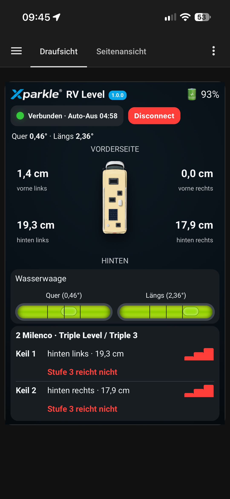
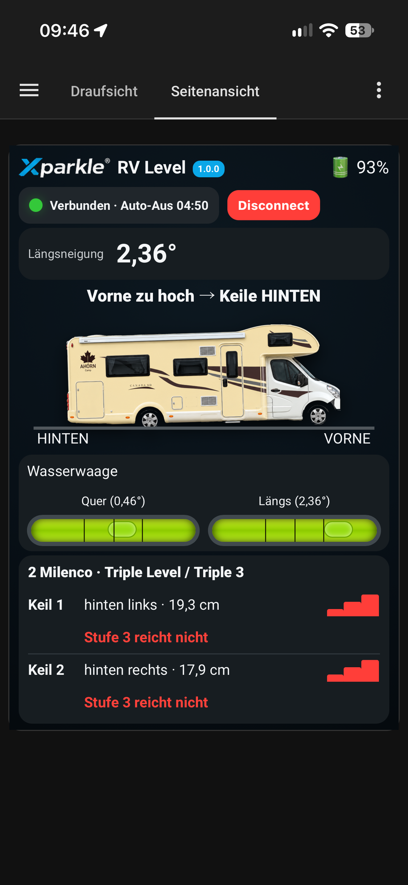
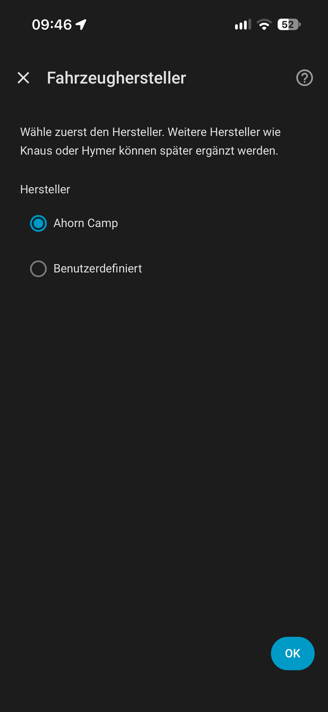
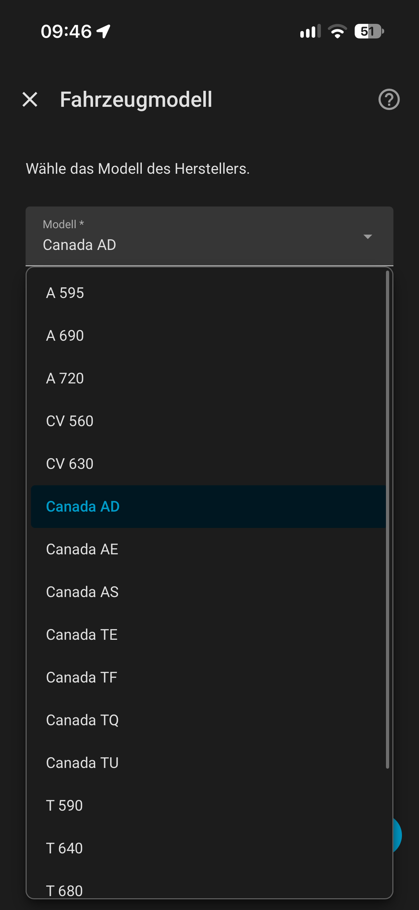
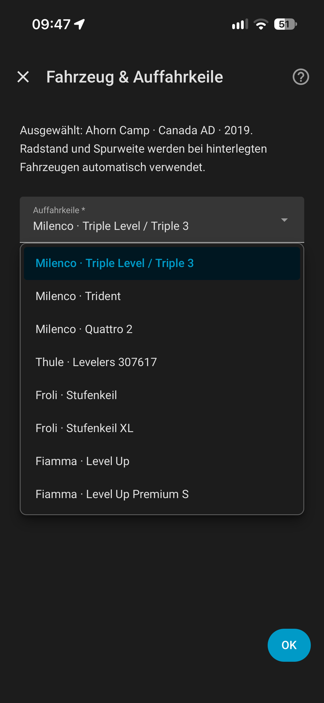

# RV Level Sensor for Home Assistant

Home Assistant integration with dashboard cards for compatible **RVLevel Bluetooth levelling sensors**. The project is not limited to a single brand and is intended for the **Xparkle RV Level Sensor** we use, as well as the **Fritz Berger RV Level Sensor**, provided the device uses the supported RVLevel BLE protocol (`RVLevel-*`, service UUID `FFF0`).

> Current stable version: **v1.0.0** · Current test version: **v1.0.1-beta.5**.

## Features

- local Bluetooth connection in Home Assistant
- transverse and longitudinal inclination
- calculated height difference at each wheel
- top view and side view
- spirit level display
- levelling wedge recommendations
- vehicle profiles and model years
- Ahorn Camp profiles 2019–2026
- Canada AD 2019 with its own original graphics
- automatic provisioning and registration of the dashboard card
- automatic detection of the matching entity prefix
- configurable sensor orientation: **Normal** or **Rotated 180°**
- English user interface, with German translations for the configuration flow and entity names

## Screenshots

### Dashboard

<table>
  <tr>
    <td align="center"><strong>Top view</strong></td>
    <td align="center"><strong>Side view</strong></td>
  </tr>
  <tr>
    <td></td>
    <td></td>
  </tr>
</table>

The dashboard card shows transverse and longitudinal inclination, the calculated lift heights, a spirit level display and the matching levelling wedge recommendation.

### Configuration

<table>
  <tr>
    <td align="center"><strong>Manufacturer</strong></td>
    <td align="center"><strong>Vehicle model</strong></td>
    <td align="center"><strong>Levelling wedges</strong></td>
  </tr>
  <tr>
    <td></td>
    <td></td>
    <td></td>
  </tr>
</table>

The configuration is designed to be extended with further vehicle manufacturers later. For built-in vehicle profiles, wheelbase and track width are applied automatically. From **v1.0.1-beta.5**, the **sensor orientation** can additionally be set to **Normal** or **Rotated 180°**. At 180°, front/rear axle and left/right are corrected accordingly for angles, wheel heights and wedge recommendations.

## Requirements

- Home Assistant with Bluetooth support or a Bluetooth proxy
- compatible RVLevel sensor within Bluetooth range
- HACS for the recommended installation

## Installation via HACS

1. Publish this repository on GitHub: `schmidtbenjamin91-web/rv-level-sensor`.
2. In Home Assistant, open **HACS → Integrations**.
3. Open **Custom repositories** from the menu.
4. Enter the repository: `https://github.com/schmidtbenjamin91-web/rv-level-sensor`
5. Select the category **Integration**.
6. Install **RV Level Sensor**.
7. Fully restart Home Assistant.
8. Open **Settings → Devices & services → Add integration → RV Level Sensor**.
9. Switch the sensor on and select the discovered `RVLevel-*` device.

### Dashboard resource

From v1.0.1, the JavaScript card is automatically registered as a module resource when Lovelace is in storage mode. The integration serves the files under `/rv-level-sensor/`. A manual resource entry is not required for a normal HACS installation.

If you are upgrading from Alpha 9.7.8 or older, remove the old manual entry such as `/local/xparkle-rv-level-card.js?v=978` once, so that the card is not loaded twice.

## Dashboard cards

From **v1.0.1-beta.3**, the matching entity prefix is detected automatically. A normal installation therefore no longer needs `entity_prefix`.

Main view:

```yaml
type: custom:xparkle-rv-level-card
```

Top view:

```yaml
type: custom:xparkle-rv-level-top-card
```

Side view:

```yaml
type: custom:xparkle-rv-level-side-card
```

If automatic detection is not possible in a particular installation, the prefix can still be specified manually, for example:

```yaml
type: custom:xparkle-rv-level-card
entity_prefix: sensor.rvlevel_410f
```

The existing entity IDs and the internal integration domain `xparkle_rvlevel` are deliberately retained throughout the v1 series, so that existing alpha installations keep working without migration. Entity IDs of existing installations are not changed by the English translation; the card recognises both the original German and the new English entity IDs.

## Supported sensors

Automatic discovery currently expects Bluetooth devices named `RVLevel-*` with the service UUID `0000fff0-0000-1000-8000-00805f9b34fb`. Brand name and housing may differ. If a Fritz Berger device ships with a different Bluetooth name or UUID, please open a GitHub issue including the Bluetooth information so that the profile can be added.

## Vehicle profiles

Vehicle selection is hierarchical: **Manufacturer → Model → Model year → Levelling wedge**. This allows further manufacturers such as Knaus, Hymer or Dethleffs to be added later.

For display purposes in the v1 series, **Canada AD 2019** keeps its own reference graphic. All other vehicles currently available use the shared vehicle graphics set. In the top view, the front is at the top and the rear at the bottom.

## Updates

New versions are published as GitHub releases, e.g. `v1.0.1`, `v1.1.0`. HACS detects new releases and can update the integration. Thanks to the version identifier of the automatically loaded card, a new frontend path is loaded with each release without the user having to change the dashboard resource manually.

## Reporting issues

Issues: `https://github.com/schmidtbenjamin91-web/rv-level-sensor/issues`

Please include your Home Assistant version, sensor model/brand name, Bluetooth device name and relevant log output. Do not post private credentials.

## Disclaimer

This is a community project and not an official integration of Xparkle, Fritz Berger, Ahorn Camp or Home Assistant. Brand and product names are used only to describe compatibility.
